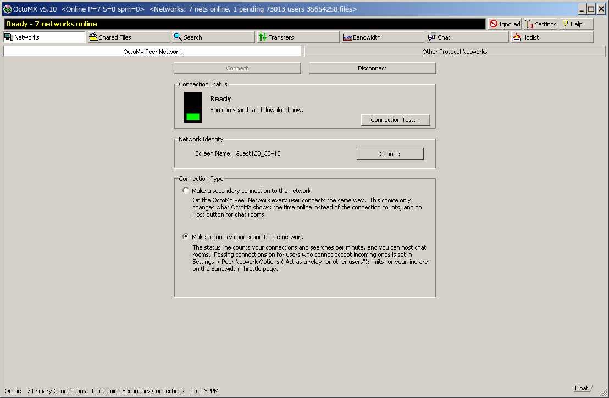
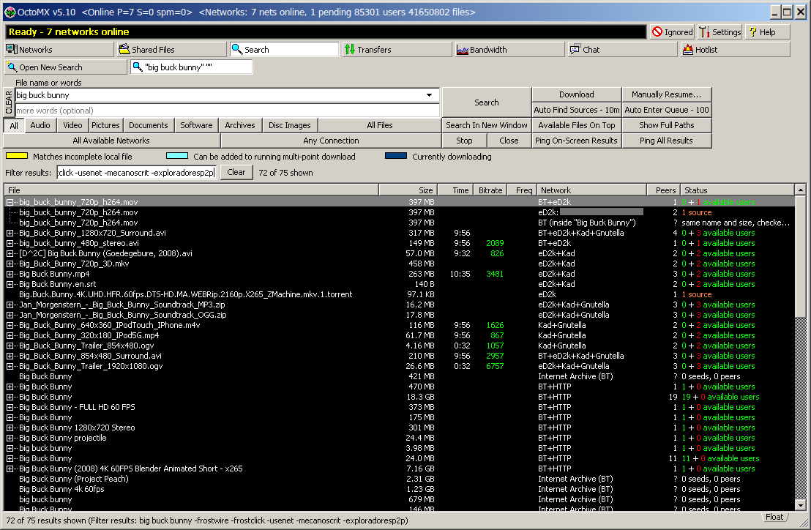
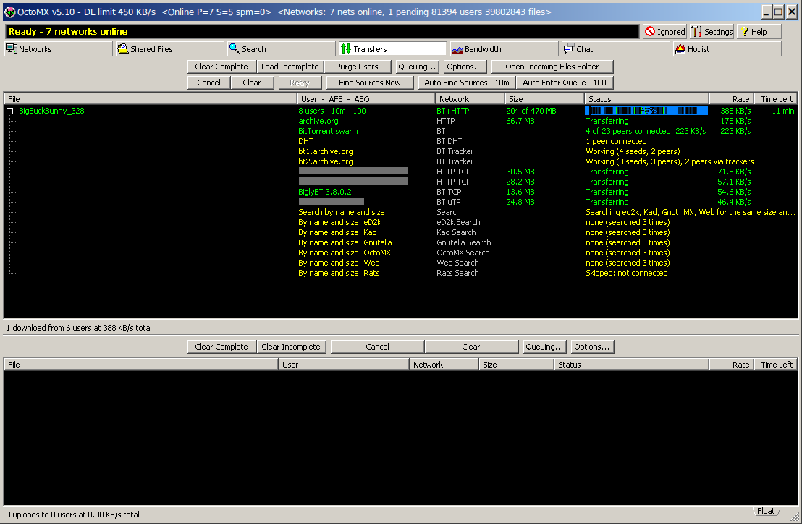
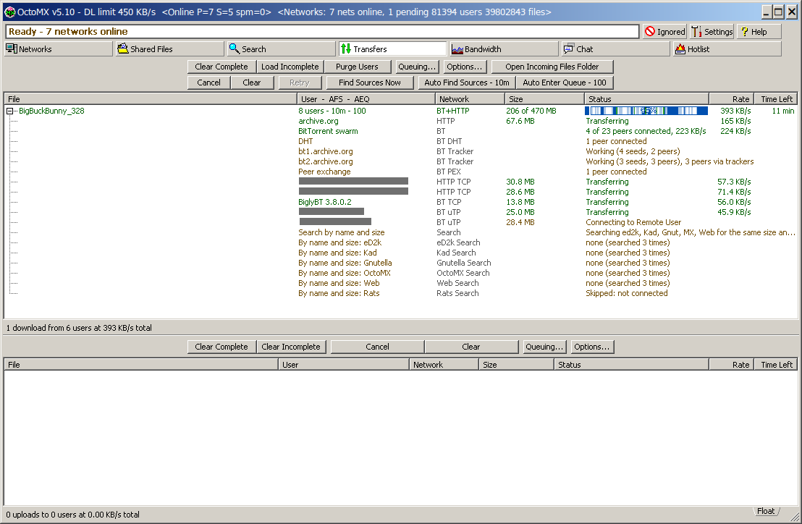
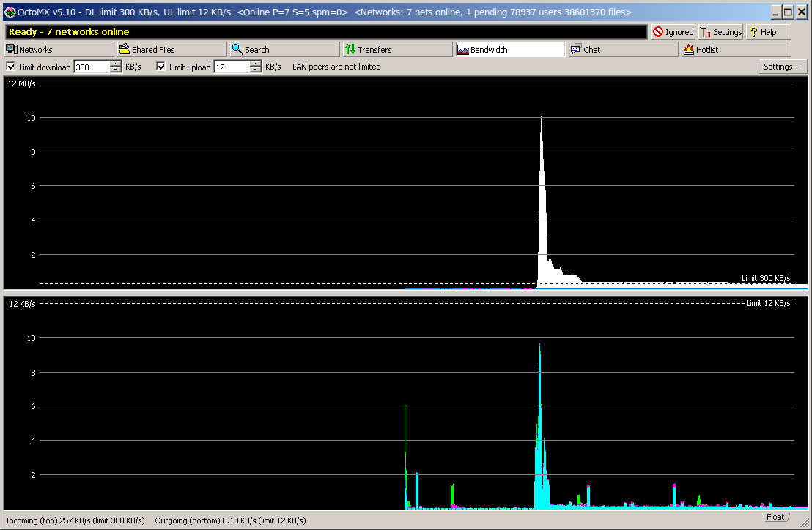
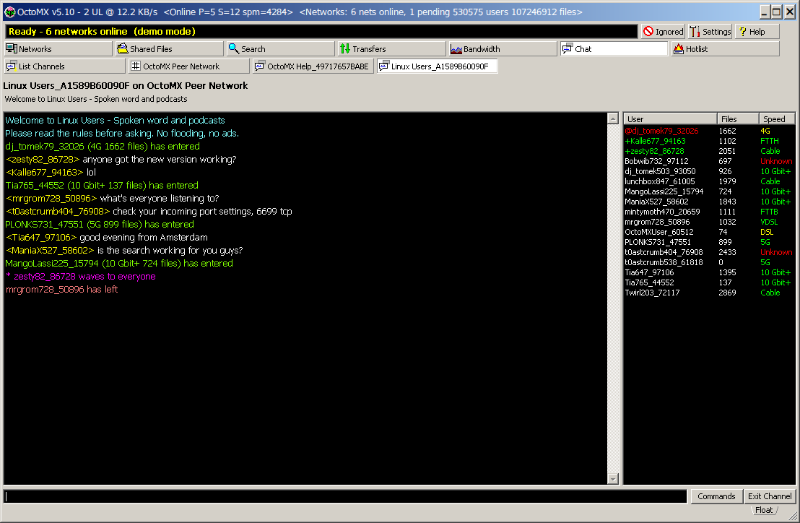
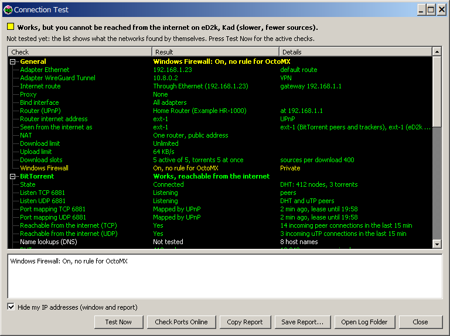
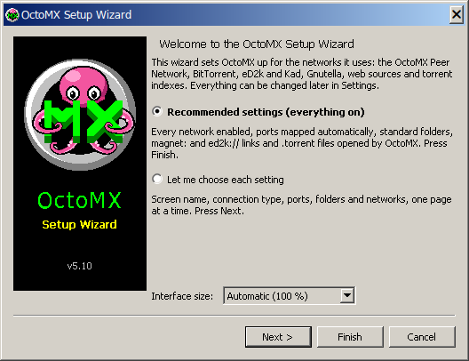

<p align="center">
  
</p>

<h1 align="center">OctoMX</h1>

<p align="center"><strong>The most innovative P2P app: 90s style, brought into the future.</strong></p>

Remember the gray window, the black lists and the green text? OctoMX is a file-sharing client
with the **classic WinMX-style interface** of the 90s file-sharing clients (search, transfers,
chat rooms, hotlist, the lot), plugged into the networks that are alive today.

* **One search, every network.** BitTorrent, eD2k and Kad, Gnutella, HTTP(S) mirrors, torrent
  indexes, the rats-search network and OctoMX's own peer network answer the same query, merged
  into one result list.
* **One download, many networks.** A single file can be fetched from several networks at the same
  time (one block from BitTorrent, the next from Kad or a web mirror), and every block is
  verified before it is kept.
* **One click.** The first-run wizard switches everything on; after that, double-click a result
  and it downloads.
* **Verify File, Restart Download.** A finished or paused download can be checked again on the
  disk (right-click it, Verify File): only the blocks that are damaged are downloaded again, the
  file stays where it is. Restart Download throws away what was received and starts from zero.
* **Careful with your files.** Closing waits until every download is written to the disk, an
  update never interrupts a write, and after a crash or a power cut the unfinished downloads are
  checked before they continue.
* **Its own network for the social part.** Chat rooms, private messages, browsing a friend's
  shared files and direct transfers run over a new, serverless OctoMX peer network.
* **Looks like 2001, runs on 2026 hardware.** Native Qt 6 application for Windows 10/11 and
  Linux, no installer, no ads, free software.

OctoMX is an independent open-source program: it is **not affiliated** with, endorsed by or
derived from the original WinMX or its makers (Frontcode Technologies), and contains none of its
code; WinMX is named only to describe the style of the interface. Its artwork is original pixel
art, and it cannot connect to the network of the original WinMX (WPN).

**Use it legally.** OctoMX was not made to promote piracy or the exchange of illegal or
copyright-protected material. It is one of many peer-to-peer programs: a general tool that lets
anyone exchange legal content (free software, public-domain and openly licensed works, your own
files) across several networks. What you search for, download and share is your choice and your
responsibility; the authors are not responsible for the content exchanged with it. At the first
start the program asks you to accept these terms before it connects to any network. See
[Legal](#legal).

Version 5.10 for Windows 10/11 (64-bit), Linux (x86_64) and macOS 14.4 or newer. Project page:
https://github.com/robtacconelli/OctoMX

> **Licence:** OctoMX is free software under the **GNU General Public License v3.0 or later**
> (`LICENSE`, the GPL's COPYING file; credits and adapted code in `NOTICE`). Third-party
> components keep their own licences (`THIRD-PARTY-NOTICES.txt` in the packages). See
> [Legal](#legal).

## Screenshots

The Windows build (run under Wine with the Windows 2000 colours). The first five
pictures are real network data; peer addresses are covered with grey bars. The only content
searched for and downloaded is the open film Big Buck Bunny (Blender Foundation, CC BY).
`tools/shots-readme.sh` retakes them all.

The Networks page, the first page you see, with the networks connected:



A search for Big Buck Bunny, answered by BitTorrent, eD2k, Kad and the Internet Archive. The same
file found on several networks is one row (here `BT+eD2k+Kad`, opened to show where it was
found); the "Filter results" field narrows the list:



A merged row downloading: one download fed by an eD2k source, a BitTorrent swarm and the Internet
Archive's HTTP mirror at the same time, with one line per source and per network. The bar in the Status column is a map of the file: blue
parts are on disk and verified, green ones are arriving right now. A download limit of 450 KB/s
is set (title bar). In the classic dark colours and in the light theme:





The Bandwidth page during that download. After the first seconds a download limit and then an
upload limit were set (the dashed lines): the rate runs along them:



A chat room, the Connection Test window and the first page of the Setup Wizard, shown with the
built-in demo data:







## Download and start

| | |
|---|---|
| **Windows** | Unzip `OctoMX-5.10-win64.zip` anywhere and double-click `octomx.exe`. Nothing is installed. Windows Firewall may ask whether OctoMX may accept connections. |
| **Linux** | `tar xf OctoMX-5.10-linux-x86_64.tar.xz` and run `OctoMX-5.10-linux-x86_64/octomx`. Qt does not need to be installed. Run `./install-desktop-entry.sh` once for a menu entry and icon. |
| **macOS** | Unzip `OctoMX-5.10-macos-universal.zip` (one app for Apple Silicon and Intel Macs, macOS 14.4 or newer) and drag `OctoMX.app` into Applications. The first time, right-click `OctoMX.app` and choose **Open**, then **Open** again (on macOS 15: System Settings > Privacy & Security > **Open Anyway**): the app has no Apple Developer ID signature. `README-mac.txt` in the archive has the details. |

`SHA256SUMS` next to the archives has their checksums.

The Linux bundle needs glibc 2.38 or newer and a libstdc++ from GCC 13.2 or newer (for example
Ubuntu 24.04, Debian 13, Fedora 39 and later), plus the normal desktop libraries (X11/xcb,
xkbcommon, fontconfig, freetype, OpenGL/libglvnd, glib 2, D-Bus) and OpenSSL 3 for HTTPS.
It uses X11; on Wayland desktops it runs through XWayland. `docs/RELEASE.md` describes how the
bundle is checked (`tools/release/verify-linux.sh` prints the exact list for a build).

## First start: the Setup Wizard

On the first start a Setup Wizard opens before any network is contacted.

* **One click:** leave "Recommended settings (everything on)" selected on the first page and
  click **Finish**. All networks are switched on, ports are mapped on your router with UPnP /
  NAT-PMP, and magnet:, ed2k:// links and .torrent files open in OctoMX.
* **Step by step:** click **Next** to set your screen name, connection type, the incoming TCP
  and UDP ports (each with a "test" button that checks whether this computer can listen on it),
  the incoming folder and shared folders, and which networks to use.

The wizard can be opened again later from the settings. Nothing is shared until you add shared
folders, except that completed downloads are shared by default (this can be turned off).

**Updates (privacy):** at start, at most once a day, OctoMX asks GitHub (`api.github.com`, the
project's latest release) whether a newer version exists; nothing else is sent (no id, no
settings, no cookies, only the `OctoMX/<version>` user agent). A newer release is then
downloaded in the background from GitHub's download hosts (`github.com` and the
`*.githubusercontent.com` addresses it forwards to, https only, through your proxy if one is set):
first the checksum list `SHA256SUMS` and its signature, and only when the signature matches the
OctoMX release key built into the program, the package for your system, whose SHA-256 must match
the signed list. Nothing is installed without that check, and nothing is installed while you work:
a box asks whether to restart now or install when you close OctoMX. Only the program's own files
(listed in `MANIFEST.txt`) are replaced; `portable.txt`, the profile, downloads and anything else
in the folder stay as they are, and the old files are kept until the next start. A copy in a
folder OctoMX cannot write to (for example Program Files) or one from another source (a
distribution package, a self-built one) is never changed: it only offers the download page. Choose
how in Settings ▸ Miscellaneous ▸ System Integration ▸ Updates: install automatically (default),
ask before downloading, only tell me, or do not check at start; Help ▸ Check for Updates... asks
at any time.

## Networks

Each network can be switched on and off on the Networks page and in the settings.

| network | what it does |
|---|---|
| **OctoMX** (own peer network) | OctoMX clients find each other (DHT rendezvous on the internet, mDNS on the LAN) for the social features of the classic WinMX-style interface: chat rooms, private messages, browsing a user's files, whois, hotlist presence, keyword search, direct file transfer between OctoMX users, and a shared registry of "hash links" that tells which BitTorrent / eD2k / SHA-1 hashes belong to the same file. Built on librats. |
| **BitTorrent** | Torrents and magnet links through libtorrent, with DHT, trackers, local peer discovery and web seeds. A torrent download can also get pieces from the other networks when the same file is known there. |
| **eD2k** | Connects to an eD2k server for search and sources, downloads from and uploads to eMule/aMule-compatible clients. |
| **Kad** | The eMule Kademlia DHT: serverless keyword search and source finding for eD2k files. |
| **Gnutella** | A Gnutella 0.6 leaf: connects to ultrapeers, searches, downloads and serves files. |
| **HTTP** | Downloads from http(s):// links and from web mirrors found by the other networks, in parallel ranges. |
| **Web** | Searches public torrent index sites and the Internet Archive over HTTPS (search only; the results are downloaded through BitTorrent / HTTP). |
| **Rats** | The rats-search P2P torrent search network (search only). |

## Local API: streaming and downloads (for players and other programs)

OctoMX can serve another program: it searches every network, picks a result and gets a link that any
video player opens (mpv, VLC, ffplay, a browser). OctoMX then fetches only what the player reads, when
it reads it (the beginning, the index at the end, sequentially with a buffer ahead, any place after a
skip), from every network that has the file, and deletes the cache afterwards. **It is off by
default**: switch it on in Settings, Other Networks, Local API, where the access token is shown.
It listens on this computer only unless you allow your home network. The three calls:

    curl -H "Authorization: Bearer $TOKEN" -H "Content-Type: application/json" \
         -d '{"text": "big buck bunny", "type": "video"}' http://127.0.0.1:17580/api/v1/searches
    curl -H "Authorization: Bearer $TOKEN" http://127.0.0.1:17580/api/v1/searches/1
    curl -H "Authorization: Bearer $TOKEN" -H "Content-Type: application/json" \
         -d '{"search": 1, "result": "<key>", "file": 1}' http://127.0.0.1:17580/api/v1/streams

The last answer has the `url` for the player. The same API **downloads files of any type** (from a
search result or a magnet / ed2k / http link) into the incoming folder, lists every download of the
Transfers window with its state, speed, sources and peers, and pauses, resumes, changes or removes
them; deleting their files needs its own switch, "Programs may delete downloaded files" (off):

    curl -H "Authorization: Bearer $TOKEN" -H "Content-Type: application/json" \
         -d '{"search": 1, "result": "<key>"}' http://127.0.0.1:17580/api/v1/downloads
    curl -H "Authorization: Bearer $TOKEN" http://127.0.0.1:17580/api/v1/downloads

Every call, the status of a stream and of a download and the safety rules are in
[docs/API.md](docs/API.md).

Streaming works with every network, like a download. For a smooth stream:

* **Pick a result by its `seeds`.** A torrent with many seeds starts in seconds and a skip takes a few
  seconds (measured with the open film Big Buck Bunny, about 350 seeds: first picture data usually
  after 3 to 10 seconds, a skip usually 1 to 6 seconds). A torrent with one seed took one to three
  minutes per skip.
* **A file that only eD2k / Kad have is not practical to stream:** those sources keep a requester
  in a queue for minutes. A stream uses every network that has the file, like a download, but only
  BitTorrent was seen to carry one at playing speed.
* **The file list of a torrent is often not known before it starts.** Selecting such a result answers
  `409 files_unknown` the first time; selecting it again streams its largest audio or video file. The
  stream's status has the name and type of the file that is streamed.
* Only audio and video files are streamed, nothing is converted, and a stream that is being played
  keeps what it fetched until it ends. A stream nobody reads for 4 hours (a setting) ends and its
  cache is deleted.

## Where your data lives (profile)

Everything the program remembers is in one profile folder: settings (`settings.json`), the
database (`octomx.db`, SQLite: transfers, library, hotlist, history ...), per-network state, the
part files of unfinished downloads and the log (`logs/octomx.log`).

* Windows: `%APPDATA%\OctoMX`
* Linux: `~/.local/share/OctoMX`
* macOS: `~/Library/Application Support/OctoMX`
* `--profile <dir>` uses any other folder, for example for a second identity or for tests.
* A file named `portable.txt` next to the executable makes it use `profile/` next to the
  executable (a portable install); on macOS both go next to `OctoMX.app`.

Completed downloads go to `Downloads/OctoMX` in your home folder unless you choose another
folder in the wizard or the settings.

## Ports, firewall and UPnP

Defaults (all changeable in the settings or in the wizard):

| network | port |
|---|---|
| OctoMX network | TCP 6699, UDP 6257 |
| BitTorrent | TCP + UDP 6881 |
| eD2k | TCP 4662, UDP 4672 |
| Kad | UDP 4672 (shared with eD2k) |
| Gnutella | TCP + UDP 6346 |
| rats-search | 4444, plus a random UDP port for its DHT |

Downloading and searching work without any open port. To be reachable by others (High ID on
eD2k, not "firewalled" on Kad and Gnutella, faster BitTorrent), the ports must be reachable from
the internet: either leave **UPnP / NAT-PMP** on (the default; your router must support it),
or forward the ports on your router yourself and allow them in your firewall (Windows Firewall,
ufw, firewalld). The Gnutella module does not map its port itself.

### Proxy and VPN adapter

Settings > Internet Connection applies to the whole program, and it fails closed:

* **Proxy** (SOCKS5 or HTTP): BitTorrent, eD2k, Gnutella, HTTP downloads, the web indexes and the
  update check go through it. What cannot go through a proxy does not run while one is set and
  says so on the Networks page: Kad, the OctoMX network, rats-search, the UDP parts of eD2k and
  Gnutella, listening for incoming connections and port mapping. Nothing connects directly.
  BitTorrent's DHT, uTP and UDP trackers work only through a SOCKS5 proxy that relays UDP.
* **Network adapter** (Connection Options, for example a VPN adapter): every network keeps to that
  adapter. When it disappears (VPN down), every network stops within about two seconds and
  starts again by itself when the adapter is back; nothing falls back to another adapter. The
  OctoMX network and rats-search run with a chosen adapter only while the system's internet
  route goes through it. Name lookups use the system's DNS.

Both were tested on Linux with local proxies, a second local address and a network namespace,
not yet with a commercial VPN or a public proxy: check your own setup with an address test.

## Command line

```
octomx [--profile <dir>] [--minimized] [--no-wizard]
       [--page <networks|shared|chat|search|hotlist|transfers|bandwidth>]
       [--demo | --demo-frozen] [--size WxH]
       [--screenshot <out.png>] [--screenshot-delay <ms>] [--script <file>]
       [--export-icons <dir>] [--help] [--version]
       [<magnet:...|ed2k://...|http(s)://...|file.torrent> ...]
```

* `--profile <dir>`: use this profile folder (see above).
* `--minimized`: start in the tray / minimized.
* `--no-wizard`: do not show the Setup Wizard on the first start.
* `--page <name>`: open this page.
* links / .torrent files: start these downloads. If OctoMX is already running with the same
  profile, they are handed to the running instance.
* `--demo`: show canned sample data without any network access (`--demo-frozen`: the same
  without time-based changes, for reproducible screenshots).
* `--size`, `--screenshot`, `--screenshot-delay`, `--script`: UI automation used by the tests
  and screenshot tools (see `src/ui/script_driver.h` for the script verbs).
* `--export-icons <dir>`: write the application icon as PNG/ICO files.

## Known limitations

Plainly, from the status reports of the people who built it:

* **Windows:** developed and tested automatically under Wine 10 on Linux, and used on real
  Windows 11 PCs by the maintainer. Reports from other Windows 10 and 11 machines are welcome.
* **Firewalled operation:** development happened behind NAT, so serving files to remote eD2k,
  Kad and Gnutella peers was only tested between our own clients; no upload to a real remote
  eD2k client and no remote Gnutella download from us were observed. A firewalled client does
  not publish its files to Kad unless it finds a buddy (as eMule).
* **eD2k / Kad:** no UDP re-asks, no secure identification / credits, no AICH recovery (a bad
  part costs one 9.28 MB re-download), no server UDP obfuscation, no Kad notes; partial files
  are not published to Kad.
* **Gnutella:** no out-of-band results / GUESS, no TLS, IPv6 or Mojito DHT; no XML metadata, so
  bitrate and length of Gnutella hits stay unknown.
* **HTTP:** FTP is not supported. **Proxy:** SOCKS4 is not supported; see "Proxy and VPN adapter"
  for what is switched off while a proxy is set.
* **OctoMX network:** two OctoMX users behind the same home router cannot connect to each other
  over the internet (no NAT hairpinning; on the same LAN they find each other through mDNS);
  chat rooms have no moderators; it is designed for a small network.
* **Web index sites** change domains and block clients from time to time; a broken site needs a
  `providers.json` update.
* **Downloads:** a torrent whose metadata never arrives does not fall back to the other networks.
* **Streaming API:** tested with ffprobe and ffmpeg as the player, not with mpv or VLC. eD2k parts
  and plain web links are played as they arrive and checked afterwards (the status counts those
  bytes). With "Allow other devices on my network" the traffic in your network is plain HTTP.
* **User interface:** a few WinMX 3.53 features are missing or simplified: the "Manually
  Resume" file dialog, hotlist display templates, binary server.met / nodes.dat import, live font
  changes, floating single chat rooms. "Shutdown when transfers stop" was only
  exercised in test mode.
* **Translations:** none ships yet. A translator runs `lupdate src -ts octomx_xx.ts`, translates the
  file in Qt Linguist, makes `octomx_xx.qm` with `lrelease` and loads it with Settings > Appearance >
  Load Language From File... (a restart shows every text).
* **Linux bundle:** X11 only (XWayland on Wayland desktops); needs a 2023-or-newer distribution
  (glibc 2.38).

## Building from source

On an x86_64 Linux host with GCC ≥ 13, CMake ≥ 3.21, Ninja, git, curl, Python 3 (venv) and
perl (full list: `docs/BUILDING.md`), from the checkout root, it may live anywhere; every
toolchain, cache and temporary file stays inside it:

```bash
source toolchain/env.sh                       # in every shell
tools/install-toolchain.sh                    # Qt 6.12.1 (Linux + win64_llvm_mingw), llvm-mingw, wine prefix
tools/build-third-party.sh                    # static zlib, OpenSSL 3.5, Boost 1.92, libtorrent 2.0.15 + librats
tools/configure-linux.sh build/my-linux && ninja -C build/my-linux -j8      # native Linux build
tools/configure-win.sh   build/my-win   && ninja -C build/my-win   -j8      # Windows cross build
ctest --test-dir build/my-linux                                           # unit tests (offline)
tools/package-win.sh build/my-win dist/my-win  # dev package of the Windows build (runs under wine)
tools/release.sh                              # the release: both packages, verified (docs/RELEASE.md)
```

Every download is pinned (versions, SHA-256, librats commit). Windows is only cross-compiled
from Linux; there is no native Windows build setup.

### Default web search sites

The Web network searches the index sites defined in `src/net/web/providers/providers.json`.
Which of them are switched **on by default** is decided in one place, the `"defaults"` object
at the top of that file, selected at build time:

```bash
tools/configure-linux.sh build/x                                        # standard: all sites on (default)
tools/configure-linux.sh build/x -DMX_WEB_DEFAULT_PROFILE=conservative  # only Internet Archive + linuxtracker on
```

With `conservative` the other sites are still present but start disabled; users can switch any
site on or off on the Networks page. Details: `src/net/web/README.md`.

More: `docs/BUILDING.md` (build in detail), `docs/ARCHITECTURE.md` (modules and interfaces),
`third_party/BUILD.md` (dependencies), `docs/RELEASE.md` (how the release is produced and
checked), `CONTRIBUTING.md`.

## Legal

* **Independent project.** OctoMX is an independent open-source program. It is not
  affiliated with, endorsed by or derived from the original WinMX or its makers (Frontcode
  Technologies), and contains none of its code; WinMX is named only to describe the style of the
  interface. It contains no icons or other artwork of the original program either; the icons are drawn in code, and screenshots of the original are not part of this
  repository (`reference/README.md`).
* **Licence.** GPL-3.0-or-later, see `LICENSE`. Some files contain code adapted from eMule
  (GPL-2.0-or-later); they are listed with credits in `NOTICE`. The binary packages include the
  licences of all bundled third-party components and say where to get the source (`SOURCE.txt`).
* **No warranty.** The program is provided "as is", without any warranty (GPL sections 15-16).
* **Purpose.** This project was not created to promote piracy, the exchange of illegal content
  or the infringement of copyright. Like many other peer-to-peer programs, it is a
  general-purpose tool for exchanging legal content across several networks.
* **Your responsibility.** You alone are responsible for what you share, search for and
  download, and for complying with copyright and other laws where you live. Only share and
  download content you have the right to.
* **No responsibility for content.** The authors and contributors do not host, index, control,
  check or endorse any content available through the networks, and are not responsible for the
  content exchanged with the program or for how it is used. The bundled web search sites and
  the networks themselves are third-party services that are not controlled by this project.

